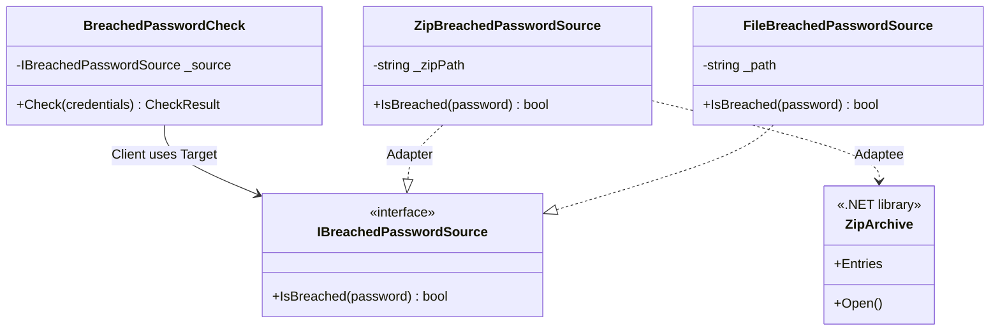
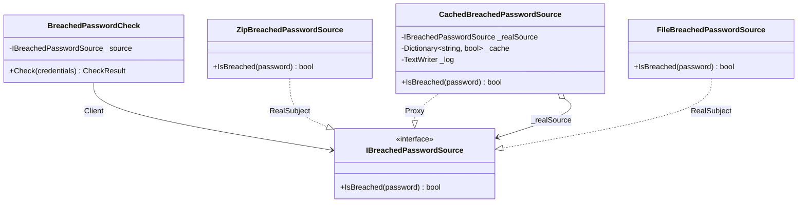
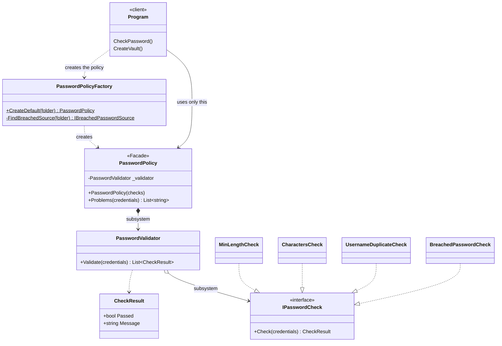

# Laboratory Work Nr. 3 — Structural Design Patterns

**Student:** Kushnirenko Ecaterina
**Academic group:** FAF-243

## Introduction

Structural design patterns show how classes and objects can be put together into bigger structures. The structures should still stay simple and easy to change.

There are 7 structural patterns:

- Adapter: makes a class with one interface work where another interface is expected.
- Bridge: splits a big class into two parts, the abstraction and the implementation, so they can change separately.
- Composite: puts objects in a tree, and a group of objects is used the same way as one object.
- Decorator: wraps an object in another object with the same interface to add new behavior.
- Facade: gives one simple interface to a group of classes.
- Flyweight: many objects share the same data, so they use less memory.
- Proxy: an object with the same interface as the real object, that controls the access to it.

In this laboratory I had to implement 3 of these patterns. I chose Adapter, Proxy and Facade.

## The project

The project is the password manager from the previous laboratories. Everything that was there stays the same. The user can still check a password, generate a password, create and open a vault and add entries from templates.

I added the new patterns in the part that checks passwords (Lab 0), because there were some problems there:

1. `rockyou.txt` is 140 MB, so in the repository there is only `rockyou.zip`. The user had to unzip it by hand. If they forgot, the leaked passwords check was just skipped and the program did not say anything.
2. Every check searched the whole list again, even for a password that was already checked before.
3. `Program.cs` created all the checks itself and filtered the failed results in two places (`CheckPassword` and `CreateVault`), so the code was repeated.

Project structure (only the new and changed files):

```
Password-Manager/
├── Password-Manager.sln                    new, so the tests run with one command
├── PasswordChecker/
│   ├── Program.cs                          changed, uses the facade
│   ├── PasswordChecker.csproj              changed, copies rockyou.zip next to the program
│   ├── PasswordPolicy.cs                   Facade
│   ├── PasswordPolicyFactory.cs            builds the default facade, connects Adapter and Proxy
│   └── PasswordCheck/
│       ├── ZipBreachedPasswordSource.cs    Adapter
│       └── CachedBreachedPasswordSource.cs Proxy
└── PasswordChecker.Tests/                  unit tests
    ├── AdapterTests.cs
    ├── ProxyTests.cs
    ├── FacadeTests.cs
    ├── ChainTests.cs                       the 3 patterns together
    └── Fakes/                              fake checks, fake source, temporary zip
```

The other classes did not change. I also renamed the folder `Generation ` to `Generation`, because it had a space at the end of the name.

The new classes work together like a chain:

```
Program.cs
   ▼
PasswordPolicy                    Facade
   ▼
BreachedPasswordCheck             Lab 0, not changed
   ▼
CachedBreachedPasswordSource      Proxy
   ▼
ZipBreachedPasswordSource         Adapter
   ▼
rockyou.zip
```

### How to run

Now nothing has to be unzipped:

```bash
cd PasswordChecker
dotnet run
```

If `rockyou.txt` is already unzipped, the program uses it, because a normal file is a bit faster to read. If not, it reads `rockyou.zip`. If neither is found, the program prints a warning, so the user knows that the leaked passwords check is not done.

Tests:

```bash
cd Password-Manager
dotnet test
```

Example, the same password is checked two times:

```
> 1
Username: bob
Password: ABCabc123!@#
[proxy] new password, searching the leaked passwords list...
password was found in a list of leaked passwords
Bad password
> 1
Username: bob
Password: ABCabc123!@#
[proxy] password was checked before, answer taken from the cache
password was found in a list of leaked passwords
Bad password
```

The first time the answer takes almost a second, the second time it is instant.

## Where the patterns are used

| Pattern | Where                                           | What it does                                                    |
|---------|-------------------------------------------------|-----------------------------------------------------------------|
| Adapter | `PasswordCheck/ZipBreachedPasswordSource.cs`    | reads the passwords directly from `rockyou.zip`                 |
| Proxy   | `PasswordCheck/CachedBreachedPasswordSource.cs` | remembers the answers, so the same password is searched once    |
| Facade  | `PasswordPolicy.cs`                             | one method `Problems(credentials)` instead of all the checks    |

## Adapter

`BreachedPasswordCheck` needs an `IBreachedPasswordSource`:

```csharp
public interface IBreachedPasswordSource{
    bool IsBreached(string password);
}
```

The .NET class `ZipArchive` can read a zip, but it has a totally different interface. It works with entries and streams and does not know anything about passwords. I can not change `ZipArchive`, it is a part of .NET. So I made an adapter. It implements `IBreachedPasswordSource` (the target) and inside it uses `ZipArchive` (the adaptee).

### Class diagram



### Code

[PasswordChecker/PasswordCheck/ZipBreachedPasswordSource.cs](PasswordChecker/PasswordCheck/ZipBreachedPasswordSource.cs)

```csharp
public class ZipBreachedPasswordSource : IBreachedPasswordSource{
    private readonly string _zipPath;

    public ZipBreachedPasswordSource(string zipPath){
        _zipPath = zipPath;
    }

    public bool IsBreached(string password){
        using ZipArchive zip = ZipFile.OpenRead(_zipPath);
        using var reader = new StreamReader(zip.Entries[0].Open());

        while (reader.ReadLine() is string line){
            if (line == password){
                return true;
            }
        }
        return false;
    }
}
```

`IsBreached` is the method the check knows. Inside, the adapter translates it into the calls `ZipArchive` understands: open the zip, open the first entry as a stream, read it line by line. There is only one file in the zip, so the adapter opens `zip.Entries[0]`. The file is unpacked while it is read, so the 140 MB are not kept in memory and nothing is saved on the disk.

`BreachedPasswordCheck` stays the same. It does not know that the passwords come from a zip now. This works because of DIP from Lab 0: the check depends on the interface, so I can give it any source.

To have the zip next to the program, I added one line in `PasswordChecker.csproj`:

```xml
<None Update="rockyou.zip" CopyToOutputDirectory="PreserveNewest" />
```

### Unit tests

[PasswordChecker.Tests/AdapterTests.cs](PasswordChecker.Tests/AdapterTests.cs). Every test makes a small temporary zip with a few passwords (`Fakes/TempZip.cs`), so the tests do not need the real `rockyou.zip`.

| Test | What it checks |
|------|----------------|
| `IsBreached_ReturnsTrue_ForPasswordInsideTheZip` | a password that is in the zip is found |
| `IsBreached_ReturnsFalse_ForPasswordNotInTheZip` | a password that is not in the zip is not found |
| `IsBreached_ComparesWholeLines_NotParts` | `password` is not found when the zip has `password123`, so the adapter compares whole lines |
| `Adapter_WorksWithTheLab0Check_WithoutChangingIt` | the old `BreachedPasswordCheck` works with the adapter without any change |

## Proxy

Searching 14 million lines takes almost a second. Sometimes the same password is checked more than once, for example the user checks it with option 1 and then uses it as the master password with option 3, or tries the same password again.

`CachedBreachedPasswordSource` is a caching proxy. It has the same interface as the real source, so the check can not see the difference. It keeps the real source inside and calls it only for passwords it did not see before.

### Class diagram



### Code

[PasswordChecker/PasswordCheck/CachedBreachedPasswordSource.cs](PasswordChecker/PasswordCheck/CachedBreachedPasswordSource.cs)

```csharp
public class CachedBreachedPasswordSource : IBreachedPasswordSource{
    private readonly IBreachedPasswordSource _realSource;
    private readonly Dictionary<string, bool> _cache = new();
    private readonly TextWriter? _log;

    public CachedBreachedPasswordSource(IBreachedPasswordSource realSource, TextWriter? log = null){
        _realSource = realSource;
        _log = log;
    }

    public bool IsBreached(string password){
        if (_cache.ContainsKey(password)){
            _log?.WriteLine("[proxy] password was checked before, answer taken from the cache");
        }
        else{
            _log?.WriteLine("[proxy] new password, searching the leaked passwords list...");
            _cache[password] = _realSource.IsBreached(password);
        }
        return _cache[password];
    }
}
```

Before calling the real source, the proxy checks its dictionary. The real source is called only when the password is not there yet. The `_log` is optional: the program gives it `Console.Out`, so the user can see when the cache is used, and the tests give it nothing.

The proxy works with both sources, `FileBreachedPasswordSource` and `ZipBreachedPasswordSource`. A new password is still searched one time, the proxy only helps when a password comes again.

The Proxy and the Decorator look the same, both wrap an object with the same interface. The difference is what they are for. A Decorator adds something new to the result. This class does not change the result at all, it only decides when the real object is called. That is why it is a Proxy.

### Unit tests

[PasswordChecker.Tests/ProxyTests.cs](PasswordChecker.Tests/ProxyTests.cs). The real source is replaced by `Fakes/CountingSource.cs`, a fake source that counts how many times it was called.

| Test | What it checks |
|------|----------------|
| `SamePasswordManyTimes_RealSourceIsCalledOnce` | the same password is checked 3 times, the real source is called only 1 time |
| `Proxy_GivesTheSameAnswerAsTheRealSource` | for a leaked and a not leaked password, the proxy answers the same as the real source, also the second time from the cache |
| `DifferentPasswords_AreEachSearchedOnce` | 2 passwords checked 2 times each give exactly 2 real searches |
| `Proxy_WritesToTheLog_WhenTheCacheIsUsed` | the second check writes the "taken from the cache" message |

## Facade

Before, `Program.cs` had to know all the Lab 0 classes: the 4 checks, `PasswordValidator`, `FileBreachedPasswordSource` and `CheckResult`. It also filtered the failed results in two places.

`PasswordPolicy` hides the validator and the results behind one method `Problems`. It gets the list of checks in the constructor, so a new check can be added without changing the facade. The default list is made in `PasswordPolicyFactory`, and that is also the place where the Adapter and the Proxy are connected.

### Class diagram



### Code

[PasswordChecker/PasswordPolicy.cs](PasswordChecker/PasswordPolicy.cs)

```csharp
public class PasswordPolicy{
    private readonly PasswordValidator _validator;

    public PasswordPolicy(List<IPasswordCheck> checks){
        _validator = new PasswordValidator(checks);
    }

    // returns only the messages of the failed checks
    public List<string> Problems(Credentials credentials){
        return _validator.Validate(credentials)
            .Where(r => !r.Passed)
            .Select(r => r.Message)
            .ToList();
    }
}
```

[PasswordChecker/PasswordPolicyFactory.cs](PasswordChecker/PasswordPolicyFactory.cs)

```csharp
public static PasswordPolicy CreateDefault(string folder){
    var checks = new List<IPasswordCheck>{
        new MinLengthCheck(12),
        new CharactersCheck(),
        new UsernameDuplicateCheck()
    };

    IBreachedPasswordSource? source = FindBreachedSource(folder);
    if (source != null){
        checks.Add(new BreachedPasswordCheck(new CachedBreachedPasswordSource(source, Console.Out)));
    }
    else{
        Console.WriteLine("Warning: rockyou.txt and rockyou.zip were not found, the leaked passwords check is skipped");
    }

    return new PasswordPolicy(checks);
}
```

The facade does not have any logic of its own, it only gives the credentials to the validator and turns the list of `CheckResult` into a list of messages. At first I made the checks inside the facade constructor, but then a new check meant changing the facade. Now the checks come from outside, and the facade stays closed for changes.

The policy is created only once in `Program.cs`, so the cache of the proxy is kept while the program runs. Before, the checks were created again at every call, so a cache would not even be possible there.

Now `Program.cs` only talks to the facade:

```csharp
var policy = PasswordPolicyFactory.CreateDefault(AppContext.BaseDirectory);

void CheckPassword(){
    List<string> problems = policy.Problems(new LoginReader().Read());
    problems.ForEach(Console.WriteLine);
    Console.WriteLine(problems.Count == 0 ? "Good password" : "Bad password");
}
```

and in `CreateVault`:

```csharp
List<string> problems = policy.Problems(new Credentials("", masterPassword));
if (problems.Count > 0){
    problems.ForEach(Console.WriteLine);
    Console.WriteLine("Choose a stronger master password");
    return;
}
```

I removed the local function `Validate` and the variable `rockYouPath` from `Program.cs`, so it became shorter. The classes behind the facade did not change and can still be used directly if someone needs the full list of `CheckResult`.

### Unit tests

[PasswordChecker.Tests/FacadeTests.cs](PasswordChecker.Tests/FacadeTests.cs). The first two tests use `Fakes/RecordingCheck.cs`, a fake check that always passes or always fails and writes down when it was called.

| Test | What it checks |
|------|----------------|
| `Problems_CallsEveryCheckInOrder_WithTheSameCredentials` | the facade calls the checks in the right order and gives each of them the same credentials |
| `Problems_ReturnsOnlyTheMessagesOfFailedChecks` | from 3 checks where 2 fail, only the 2 messages are returned |
| `Problems_IsEmpty_WhenAllChecksPass` | with the real Lab 0 checks, a strong password has no problems |
| `Problems_ListsEveryProblem_OfAWeakPassword` | with the real Lab 0 checks, `bob1` for user `bob` has 3 problems |

## The patterns together

[PasswordChecker.Tests/ChainTests.cs](PasswordChecker.Tests/ChainTests.cs) tests the whole chain Facade → Proxy → Adapter with a temporary zip.

| Test | What it checks |
|------|----------------|
| `FacadeProxyAdapter_FindLeakedPasswordInTheZip` | the facade reports a password that is in the zip and accepts one that is not |
| `FacadeProxyAdapter_SecondCheckOfTheSamePassword_DoesNotOpenTheZipAgain` | after the first check the zip is deleted, the second check still works, because the proxy does not call the adapter again |

## Test results

```
$ dotnet test --logger "console;verbosity=normal"
  Passed ProxyTests.Proxy_WritesToTheLog_WhenTheCacheIsUsed [6 ms]
  Passed AdapterTests.Adapter_WorksWithTheLab0Check_WithoutChangingIt [6 ms]
  Passed FacadeTests.Problems_IsEmpty_WhenAllChecksPass [6 ms]
  Passed AdapterTests.IsBreached_ReturnsTrue_ForPasswordInsideTheZip [< 1 ms]
  Passed AdapterTests.IsBreached_ComparesWholeLines_NotParts [< 1 ms]
  Passed ProxyTests.SamePasswordManyTimes_RealSourceIsCalledOnce [< 1 ms]
  Passed FacadeTests.Problems_ListsEveryProblem_OfAWeakPassword [< 1 ms]
  Passed AdapterTests.IsBreached_ReturnsFalse_ForPasswordNotInTheZip [< 1 ms]
  Passed ProxyTests.Proxy_GivesTheSameAnswerAsTheRealSource(password: "qwerty") [< 1 ms]
  Passed ProxyTests.Proxy_GivesTheSameAnswerAsTheRealSource(password: "Xk9#mP2$vL7!") [< 1 ms]
  Passed ProxyTests.DifferentPasswords_AreEachSearchedOnce [< 1 ms]
  Passed FacadeTests.Problems_ReturnsOnlyTheMessagesOfFailedChecks [2 ms]
  Passed ChainTests.FacadeProxyAdapter_FindLeakedPasswordInTheZip [11 ms]
  Passed FacadeTests.Problems_CallsEveryCheckInOrder_WithTheSameCredentials [< 1 ms]
  Passed ChainTests.FacadeProxyAdapter_SecondCheckOfTheSamePassword_DoesNotOpenTheZipAgain [1 ms]
Total tests: 15
     Passed: 15
```

## Conclusion

In this laboratory I added 3 structural patterns to the password manager: Adapter, Proxy and Facade.

- Because of Adapter, the program reads the leaked passwords directly from `rockyou.zip`, so the user does not have to unzip a 140 MB file.
- Because of Proxy, a password that was already checked is not searched again.
- Because of Facade, `Program.cs` uses one class and one method instead of all the checking classes, and the repeated code is gone.

The 3 patterns work together as a chain and none of the old Lab 0 classes changed. The Adapter and the Proxy were easy to add because `BreachedPasswordCheck` depends on the interface `IBreachedPasswordSource`, the same DIP from Lab 0.

What was harder than expected:

- The Facade. My first version made all the checks inside its own constructor. It worked, but adding a new check meant changing the facade, so it was not open for extension, and I could not test it with fake checks. I had to move the creation of the checks to `PasswordPolicyFactory` and give them to the facade from outside.
- Telling the Proxy and the Decorator apart, because in the code they look almost the same. The difference is only in the intent.
- Testing the Adapter without the real 140 MB file. I solved it by making a small zip in a temporary folder in every test.

What I would design differently:

- The proxy keeps the passwords as plain text in memory. For a password manager it would be better to keep a hash of the password as the key of the dictionary.
- The adapter reads the whole zip again for every new password. If many different passwords had to be checked, it would be better to load the list once into a `HashSet`, but that needs a lot of memory, so for this program the proxy was enough.
- The factory writes the warning directly to the console. It would be cleaner to give it a `TextWriter`, like the proxy has.

I understood that structural patterns are mostly about wrapping objects. The Adapter changes the interface, the Proxy keeps the same interface but controls the access, and the Facade makes a new simpler interface for many objects.
