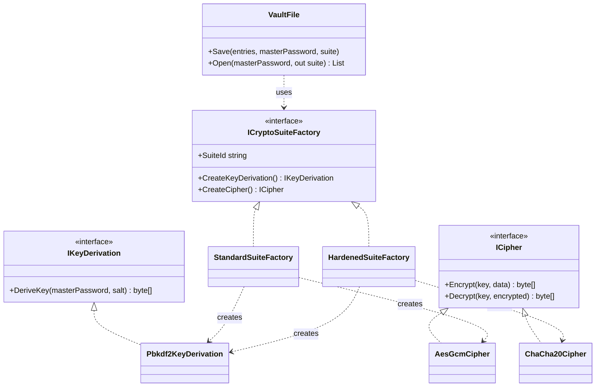
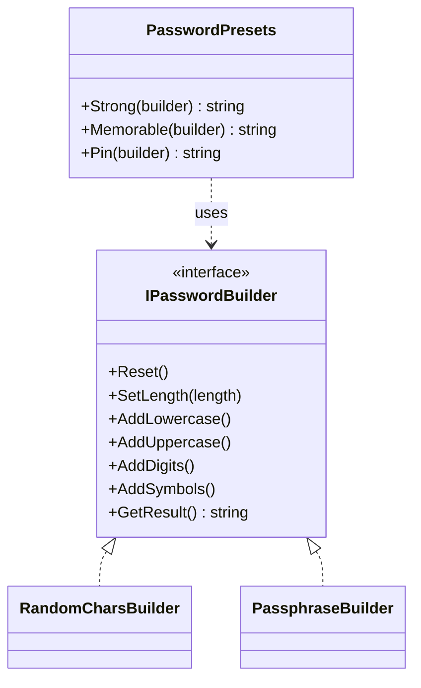
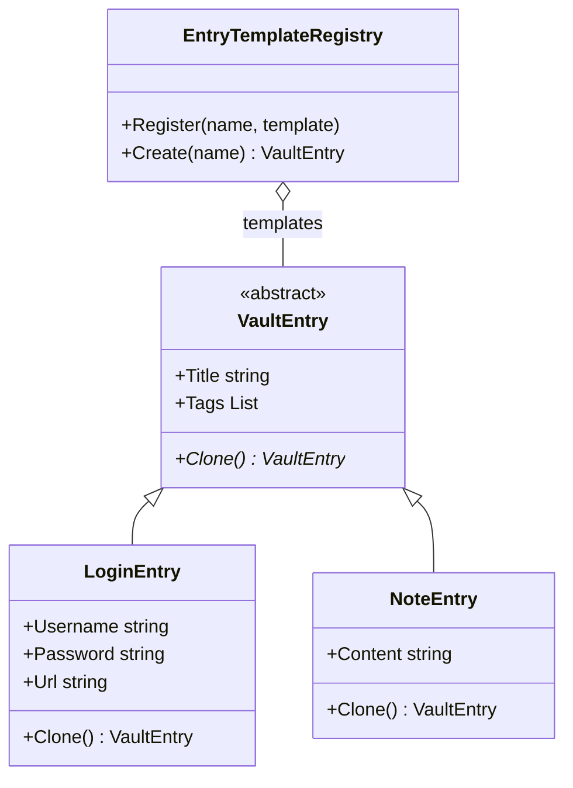

# Laboratory Work Nr. 2 — Creational Design Patterns

**Student:** Kushnirenko Ecaterina
**Academic group:** FAF-243

## Introduction

Creational design patterns show how objects can be created. Instead of writing `new` with a concrete class in every place, the creation is moved to separate classes or methods. Then the code does not depend on the concrete classes.

There are 5 creational patterns:

- Singleton: a class has only one object, and there is one global point to get it.
- Factory Method: a method in a parent class creates an object, and the child classes decide which class to create.
- Abstract Factory: an interface that creates families of objects that work together, without naming their concrete classes.
- Builder: an object is built step by step. The same steps can give different results.
- Prototype: a new object is created by copying an object that already exists.

In this laboratory I had to implement 3 of these patterns. I chose Abstract Factory, Builder and Prototype.

## The project

In Lab 0 I made a password checker. In this laboratory I continued it and made a password manager. The user can:

1. create a vault, a file with encrypted entries, protected by a master password;
2. open the vault with the master password;
3. generate a password, a passphrase or a PIN;
4. add entries to the vault from templates.

The classes from Lab 0 stay the same. They are used to check the master password.

Project structure:

```
PasswordChecker/
├── Program.cs                     shows the menu and creates the objects
├── GlobalUsings.cs
├── LoginReader.cs                 Lab 0
├── Credentials.cs                 Lab 0
├── CheckResult.cs                 Lab 0
├── PasswordValidator.cs           Lab 0
├── PasswordCheck/                 Lab 0 checks
├── Crypto/                        Abstract Factory
│   ├── ICryptoSuiteFactory.cs     abstract factory
│   ├── StandardSuiteFactory.cs    concrete factory 1
│   ├── HardenedSuiteFactory.cs    concrete factory 2
│   ├── IKeyDerivation.cs          abstract product A
│   ├── ICipher.cs                 abstract product B
│   ├── Pbkdf2KeyDerivation.cs     concrete product A
│   ├── AesGcmCipher.cs            concrete product B1
│   ├── ChaCha20Cipher.cs          concrete product B2
│   └── CryptoSuites.cs            finds the factory by its id
├── Generation/                    Builder
│   ├── IPasswordBuilder.cs        builder
│   ├── RandomCharsBuilder.cs      concrete builder 1
│   ├── PassphraseBuilder.cs       concrete builder 2
│   ├── PasswordPresets.cs         director
│   └── WordList.cs                words for the passphrases
├── Entries/                       Prototype
│   ├── VaultEntry.cs              prototype
│   ├── LoginEntry.cs              concrete prototype
│   ├── NoteEntry.cs               concrete prototype
│   └── EntryTemplateRegistry.cs   stores the templates
└── Storage/
    └── VaultFile.cs               saves and opens the vault (client of the abstract factory)
```

### How to run

```bash
cd PasswordChecker
dotnet run
```

Example:

```
2. Generate a password
> 1
Generated: +G?8vVKoKy&pqK=L3o86

2. Generate a password
> 2
Generated: Sponge#Breeze#Umbrella#Ocean7

3. Create a vault
1. Standard (PBKDF2-SHA256 + AES-GCM)
2. Hardened (PBKDF2-SHA512 + ChaCha20-Poly1305)
> 2
New master password: Correct-Horse-Battery-9!
Vault created

5. Add an entry from a template
1. work-login
2. social-login
3. wifi
> 1
Username: katya
Generated password: =&OFEdF*hBkm+1tcEvY2
Saved: [login] Work account - katya https://sso.company.com [work, sso]

4. Open the vault
Master password: wrong
Wrong master password
```

## Where the patterns are used

| Pattern          | Where                                                                                     |
|------------------|-------------------------------------------------------------------------------------------|
| Abstract Factory | `Crypto/`: `ICryptoSuiteFactory`, `StandardSuiteFactory`, `HardenedSuiteFactory`, used in `VaultFile` |
| Builder          | `Generation/`: `IPasswordBuilder`, `RandomCharsBuilder`, `PassphraseBuilder`, `PasswordPresets` |
| Prototype        | `Entries/`: `VaultEntry`, `LoginEntry`, `NoteEntry`, `EntryTemplateRegistry`              |

## Abstract Factory

To encrypt the vault, the program needs 2 algorithms:

- a key derivation function. It turns the master password into a key;
- a cipher. It encrypts the entries with this key.

These 2 algorithms are used together. If the vault was saved with one pair, it must be opened with the same pair. So they are a family of objects.

I made 2 families. Each family is one factory:

| Factory  | Key derivation | Cipher            |
|----------|----------------|-------------------|
| Standard | PBKDF2-SHA256  | AES-GCM           |
| Hardened | PBKDF2-SHA512  | ChaCha20-Poly1305 |

UML diagram:



The abstract factory is an interface with one method for every product:

```csharp
public interface ICryptoSuiteFactory{
    string SuiteId { get; }
    IKeyDerivation CreateKeyDerivation();
    ICipher CreateCipher();
}
```

Every concrete factory creates its own pair:

```csharp
public class StandardSuiteFactory : ICryptoSuiteFactory{
    public string SuiteId => "standard";

    public IKeyDerivation CreateKeyDerivation(){
        return new Pbkdf2KeyDerivation(HashAlgorithmName.SHA256, 600_000);
    }

    public ICipher CreateCipher(){
        return new AesGcmCipher();
    }
}
```

`VaultFile` is the client. It works only with the interfaces, so it does not know which algorithms are used:

```csharp
public void Save(List<VaultEntry> entries, string masterPassword, ICryptoSuiteFactory suite){
    byte[] salt = RandomNumberGenerator.GetBytes(16);
    byte[] key = suite.CreateKeyDerivation().DeriveKey(masterPassword, salt);

    byte[] json = JsonSerializer.SerializeToUtf8Bytes(entries);
    byte[] encrypted = suite.CreateCipher().Encrypt(key, json);

    var data = new VaultFileData(suite.SuiteId, salt, encrypted);
    File.WriteAllText(_path, JsonSerializer.Serialize(data));
}
```

The id of the factory is saved in the file together with the encrypted entries. When the vault is opened, `CryptoSuites.FromId` returns the same factory that was used to save it:

```csharp
suite = CryptoSuites.FromId(data.SuiteId);
byte[] key = suite.CreateKeyDerivation().DeriveKey(masterPassword, data.Salt);
byte[] json = suite.CreateCipher().Decrypt(key, data.EncryptedEntries);
```

If the master password is wrong, the cipher throws a `CryptographicException` and the program shows "Wrong master password".

Without this pattern, `VaultFile` would have `if (suite == "standard") ... else ...` in `Save` and in `Open`, and the 2 algorithms could be mixed by mistake. With the factory, if I want to add a new family, I write one new factory class and add it to `CryptoSuites`. `VaultFile` stays the same.

## Builder

A password can be made in different ways: with a different length, with or without uppercase letters, digits and symbols, from characters or from words. With a constructor it would look like `new Password(20, true, true, true, false)`, and it is not clear what every parameter means.

With the Builder pattern the password is made step by step. The steps are in the interface `IPasswordBuilder`:

```csharp
public interface IPasswordBuilder{
    void Reset();
    void SetLength(int length);
    void AddLowercase();
    void AddUppercase();
    void AddDigits();
    void AddSymbols();
    string GetResult();
}
```

There are 2 concrete builders. They have the same steps, but the result is different:

- `RandomCharsBuilder` makes a password from characters, for example `+G?8vVKoKy&pqK=L3o86`;
- `PassphraseBuilder` makes a password from words, for example `Sponge#Breeze#Umbrella#Ocean7`.

The director is `PasswordPresets`. It knows the recipes, which steps to call and in which order. There are 3 recipes: `Strong`, `Memorable` and `Pin`.

UML diagram:



The recipe `Strong`:

```csharp
public string Strong(IPasswordBuilder builder){
    builder.Reset();
    builder.SetLength(20);
    builder.AddLowercase();
    builder.AddUppercase();
    builder.AddDigits();
    builder.AddSymbols();
    return builder.GetResult();
}
```

The director does not know which builder it gets. So the same recipe gives a different result with another builder. In `Program.cs`:

```csharp
presets.Strong(charsBuilder);   // +G?8vVKoKy&pqK=L3o86
presets.Strong(phraseBuilder);  // Sponge#Breeze#Umbrella#Ocean7
```

In `RandomCharsBuilder`, `GetResult` first takes one character from every chosen set, so the password always has every type of character. Then it adds characters until the length is reached and mixes them:

```csharp
foreach (string set in _sets){
    password.Add(set[RandomNumberGenerator.GetInt32(set.Length)]);
}
while (password.Count < _length){
    password.Add(allChars[RandomNumberGenerator.GetInt32(allChars.Length)]);
}

char[] result = password.ToArray();
RandomNumberGenerator.Shuffle<char>(result);
```

I used `RandomNumberGenerator` and not `Random`, because the results of `Random` can be predicted.

If I want a new type of password, I write a new builder class. If I want a new recipe, I add a method to `PasswordPresets`. The builders stay the same.

## Prototype

Many entries in the vault are almost the same. For example, all work accounts have the same URL and the same tags `work` and `sso`. Without a pattern, I would write the same values again for every new entry.

With the Prototype pattern, the program stores templates. A new entry is a copy of a template. Every entry can copy itself with the method `Clone()`:

```csharp
public abstract class VaultEntry{
    public string Title { get; set; } = "";
    public List<string> Tags { get; set; } = new();

    public abstract VaultEntry Clone();
}
```

UML diagram:



`LoginEntry` implements `Clone()`:

```csharp
public override VaultEntry Clone(){
    var copy = (LoginEntry)MemberwiseClone();
    copy.Tags = new List<string>(Tags);
    return copy;
}
```

`MemberwiseClone()` makes a shallow copy. The strings are copied, but `Tags` is still the same list as in the template. I checked it: when I removed the line with `new List<string>(Tags)` and added a tag to one entry, the tag also appeared in the template and in the other entries made from it. So I create a new list for `Tags`, and this makes a deep copy.

The templates are stored in `EntryTemplateRegistry`. It does not need to know the concrete classes, it only calls `Clone()`:

```csharp
public VaultEntry Create(string name){
    return _templates[name].Clone();
}
```

The templates are added in `CreateDefault`:

```csharp
registry.Register("work-login", new LoginEntry{
    Title = "Work account",
    Url = "https://sso.company.com",
    Tags = new List<string>{ "work", "sso" }
});
```

If I want a new template, I add one more `Register` call. I do not need a new class.

The Prototype and the Builder are used together. When a login is added from a template, the password is generated with the recipe `Strong`:

```csharp
VaultEntry entry = templates.Create(names[number - 1]);

if (entry is LoginEntry login){
    Console.Write("Username: ");
    login.Username = Console.ReadLine() ?? "";
    login.Password = presets.Strong(charsBuilder);
}
```

## Conclusion

In this laboratory I continued the password checker from Lab 0 and made a password manager. I used 3 creational patterns: Abstract Factory, Builder and Prototype.

- Because of Abstract Factory, the key derivation and the cipher are always created as a pair, and `VaultFile` does not depend on the concrete algorithms.
- Because of Builder, the password is made step by step, and the same recipe can make a password from characters or from words.
- Because of Prototype, new entries are copies of templates. I also understood the difference between a shallow copy and a deep copy.

The Lab 0 classes did not change. I only used them to check the master password. Because of the SOLID principles from Lab 0, it was easy to add new code without changing the old one.